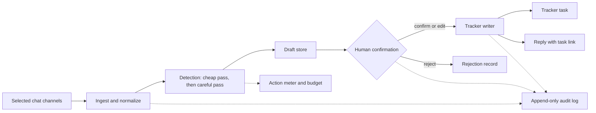

# Seros product specification

[](https://github.com/Seros-LLC/seros/actions/workflows/docs-checks.yml)

Seros is a documentation-first specification for a paused product that turns commitments,
requests, and decisions already written in team chat into proposed, owned, dated tasks in a
team's tracker.

> Status: specified; the product implementation is paused. This repository is the design
> record, not a deployed service. The implementation lives in
> [Seros-LLC/app](https://github.com/Seros-LLC/app), which is not deployed or sold.

The specification is retained because its engineering decisions remain useful: every task
write requires human confirmation, customer content is excluded from logs, and every model
call is metered.

## What the product was designed to do

The v0 loop is deliberately narrow:

1. Read only the channels an administrator selected.
2. Normalize messages and replay up to 30 days of history at connection time.
3. Detect commitments, requests, and decisions using a batched, two-pass pipeline.
4. Draft a task with a title, outcome, acceptance condition, suggested owner, optional due
   date, and source permalink.
5. Show the draft in a confirmation queue.
6. After an authenticated human confirms or edits it, create the task in one connected
   tracker and reply with its link in the source thread.

The replay is the same pipeline pointed at recent history: the default design window is
7 days, with up to 30 days supported at connection time. It is not a separate inference
path.



## Non-negotiable design rules

These are product invariants, not style preferences:

1. **Human confirmation before any write.** No code path may create, update, assign, or
   comment in a customer's tracker or chat without a recorded confirmation tied to a real,
   authenticated member. The tracker writer accepts a confirmation id, never a draft id.
2. **No customer content in logs.** Logs contain identifiers, counts, durations, and error
   classes. They do not contain message text, task titles, quoted context, names, or email
   addresses. Structured logging uses an explicit allowlist.
3. **Every model call is metered.** Each provider call records its workspace, purpose, model,
   prompt version, token counts, estimated cost, latency, and outcome. The provider
   abstraction checks budgets before making the network call.

The failure rule is: degrade toward doing nothing, never toward acting without a human.

## Technology stack

### Chosen

- **TypeScript on Node.js** — accepted in [ADR 0005](docs/adr/0005-language-and-runtime-typescript.md).
- **Drizzle ORM** over SQLite for development, with a Postgres-shaped schema.
- **Server-rendered pages** with no client framework for the specified v0 application.
- **Provider abstraction** from the first model call. Model tiers are named by role (`cheap`,
  `standard`, and optionally `careful`), not by vendor.

The archived TypeScript spike requires Node.js `>=22.18`; this is the only version constraint
recorded in the repository's executable package manifest.

### Deliberately open or historical

- [ADR 0004](docs/adr/0004-model-provider-strategy.md) is **proposed, not accepted**. No
  model provider is formally chosen by this repository.
- The v0 tracker, cloud, queue product, and production database product were not fixed by the
  specification.
- Before the pause, the separate application used a hosted model in front of a local Qwen
  fallback. That is historical operational context, not an accepted architecture decision.

## Architecture

The intended system has three boundaries:

- **Customer systems:** selected chat channels and one connected tracker.
- **Authenticated edge:** webhook receiver plus the confirmation API and web application.
- **Tenant-scoped core:** normalization, detection, drafting, deduplication, draft storage,
  confirmation, tracker writes, roster synchronization, queues, metering, and audit logging.

The model boundary receives only minimized input through the provider abstraction. The core has
separate read and write paths for the tracker. Detection can produce drafts, but it cannot
write to a customer system; only the confirmation queue can enqueue a tracker write.

The main processing chain is:

```text
SourceMessage -> Candidate -> Draft -> Confirmation -> Task
```

Every tenant-owned record carries a workspace id in its key path. Background jobs use a scoped
accessor that refuses to build a query without a workspace id. The design also calls for row
level security where the selected database supports it.

See [docs/ARCHITECTURE.md](docs/ARCHITECTURE.md) for components, trust boundaries, queues,
idempotency, failure behavior, tenancy, and cost controls. The entities and retention classes
are defined in [docs/DATA-MODEL.md](docs/DATA-MODEL.md).

## Key features in the specification

- Explicit channel allowlists and least-privilege integration scopes.
- Live ingest plus a bounded historical replay at connection time.
- Cheap-model-first detection with batching, pre-filters, bounded context, and abstention.
- Draft deduplication against open tracker tasks without granting the dedupe path write
  access.
- Human confirmation from the web queue or a signed chat action.
- Idempotent tracker writes keyed by the confirmation id; ambiguous writes go to review
  rather than being retried blindly.
- Append-only, exportable, content-free audit events.
- Per-workspace inference budgets and a global spend circuit breaker.
- Retention sweeps, disconnect cleanup, person-data deletion, and workspace deletion paths.
- Versioned prompts and offline evaluation on a golden set before model-affecting changes.

These are specified behaviors, not a claim that the paused product currently provides them.

## Getting started

This repository contains documentation and archived spike evidence. No application service is
started from the repository root, and no production deployment is available.

### Read the specification

```bash
git clone https://github.com/Seros-LLC/seros.git
cd seros
```

Start with:

1. This README for status, invariants, and the system loop.
2. [docs/ARCHITECTURE.md](docs/ARCHITECTURE.md) for the system design.
3. [docs/DATA-MODEL.md](docs/DATA-MODEL.md) for entities and retention.
4. [docs/SECURITY-CONTROLS.md](docs/SECURITY-CONTROLS.md) for control mappings.
5. [docs/TESTING-STRATEGY.md](docs/TESTING-STRATEGY.md) for deterministic tests and model
   evaluation.
6. [docs/RUNBOOK.md](docs/RUNBOOK.md) for failure handling and on-call expectations.
7. [docs/adr/](docs/adr/0001-record-architecture-decisions.md) for decisions and their
   evidence.

### Run the archived TypeScript spike (optional)

The spike is evidence for ADR 0005. It is not maintained and must not be used in production.
It requires Node.js `>=22.18`:

```bash
cd spikes/typescript
npm install
npm test
```

The spike test command runs the TypeScript type checker, the tenant-scope lint, and its
Node test suite. The maintained application has separate setup and verification instructions
in the [Seros-LLC/app README](https://github.com/Seros-LLC/app#readme).

### Check documentation locally

The repository's CI workflow checks relative Markdown links, ADR status sections, committed
secret patterns, and implemented security controls. The canonical commands are in
[.github/workflows/docs-checks.yml](.github/workflows/docs-checks.yml); CI runs them on pushes
to `main`, pull requests, and manual dispatches.

## Project structure

```text
.
├── docs/
│   ├── adr/                 Architecture decision records
│   ├── ARCHITECTURE.md      Components, data flow, trust boundaries, failure behavior
│   ├── DATA-MODEL.md        Entities, classifications, and retention
│   ├── IMPLEMENTATION-BRIEF.md
│   ├── INTEGRATIONS.md      External scopes and failure behavior
│   ├── RUNBOOK.md            Operational response for the intended service
│   ├── SECURITY-CONTROLS.md Control-to-implementation mapping
│   └── TESTING-STRATEGY.md  Deterministic tests and model evaluation
├── spikes/
│   ├── typescript/           Chosen-runtime evidence; archived
│   └── python/               Alternative-runtime evidence; archived
├── .github/workflows/
│   └── docs-checks.yml       Documentation and repository safety checks
├── CONTRIBUTING.md            Repository-specific contribution rules
├── COMPANY.md                 Repository context and scope
├── LICENSE                    Proprietary terms
└── README.md                  This overview
```

Application code does not belong in this repository. The separate implementation repository
is [Seros-LLC/app](https://github.com/Seros-LLC/app). The `spikes/` directory is archived
comparison evidence and should not be imported by application code.

## Development workflow

This is a documentation-first repository. Changes follow these rules:

- Change a product principle through an ADR, not an untracked prose edit.
- Do not describe a vendor, framework, language, or model as chosen unless an accepted ADR
  supports it.
- Mark assumptions explicitly with `ASSUMPTION`.
- Do not invent benchmarks, costs, accuracy figures, or customer results.
- Keep customer content out of fixtures, examples, screenshots, and issue descriptions.
- Keep relative Markdown links within this repository; cross-repository references use the
  repository URL.
- A security control may be marked `Implemented` only when it links to an existing artefact.

CI is documentation-focused rather than an application build. The workflow runs on pull
requests and pushes to `main`. No branching strategy or release cadence is prescribed in this
repository; follow the organization-wide contribution guidance for issues, pull requests,
commits, review, and security reporting.

## Coding and writing standards

- Use Markdown with ATX headings.
- Prefer tables when they make a comparison or mapping clearer than prose.
- Write plain, concrete sentences that remain readable during an incident.
- State unknowns and assumptions instead of silently turning them into facts.
- Use no emoji in documents or commit messages.
- Preserve the distinction between a specification, an implementation, and a deployed or
  measured result.

The detailed repository-specific rules are in [CONTRIBUTING.md](CONTRIBUTING.md).

## Testing and verification

The testing strategy separates deterministic plumbing from model judgment:

- **Deterministic code** gets ordinary automated assertions for webhook verification,
  idempotency, confirmation gates, tenancy, authorization, logging hygiene, metering, budget
  caps, retention, deletion, and integration failure handling.
- **Model behavior** is measured against a versioned golden set. Exact model output strings are
  not asserted.
- Tests must run offline and must not require a live model provider or live customer API.
- Third-party integrations use scrubbed recorded interactions in CI; a separate sandbox
  contract test may exercise the real loop without touching customer workspaces.
- Prompt changes require an offline evaluation attached to the pull request, including the
  corpus version, model and tier, before/after metrics, cost, and changed decisions.
- Precision must not regress against the established baseline. No absolute precision target is
  claimed before a first baseline run.

The implementation repository has its own test and verification gate. This repository's CI
checks the documentation and control mappings described above.

## Contributing

Read [CONTRIBUTING.md](CONTRIBUTING.md) before editing. The organization-wide guide in
[Seros-LLC/.github](https://github.com/Seros-LLC/.github) covers the shared contribution,
review, security, and ownership rules.

For a change to the specification:

1. Identify the source document and the invariant or assumption affected.
2. Update the relevant specification and any cross-references.
3. Add or update an ADR when the change is a product or architecture decision.
4. Keep links relative and run the documentation checks.
5. Do not present archived spike evidence or intended behavior as live product capability.

## License

This repository is proprietary. See [LICENSE](LICENSE) for the terms governing viewing,
quoting, contributions, copying, modification, and distribution.
